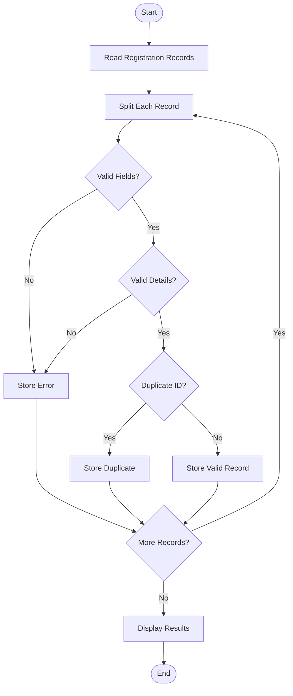

# Case Study 91: Advanced String-Based Registration Record Analyzer
## 1. Problem Statement
Develop a Python program to analyze student registration records stored in string format. The program should parse structured registration strings, validate field lengths and formats, extract student details such as Registration ID, Name, Branch, and Year, detect duplicate registration IDs, and classify errors.
The program uses strings, split(), conditional statements, loops, lists, and sets to process registration records efficiently.
## 2. Algorithm
1. Start the program.
2. Initialize a list containing student registration records.
3. Create empty lists for valid records, duplicate records, and errors.
4. Create an empty set to track previously used registration IDs.
5. Read each registration record from the list.
6. Split the record using a comma separator.
7. Check whether the record contains exactly four fields.
8. Validate the following fields:
   - Registration ID must contain six characters.
   - Student name must contain only alphabets and at least three characters.
   - Branch must be IT, CSE, EEE, or ME.
   - Year must contain exactly four digits.
9. Check whether the registration ID already exists.
10. If the ID is repeated, classify it as a duplicate.
11. Store valid records separately.
12. Display valid records, duplicate IDs, and error classifications.
13. Stop the program.

## 3. Flowchart

## 5. Sample Input
The following registration records are given as input:
STU101,YESHWITHA,IT,2026
STU102,RAHUL,CSE,2026
STU103,PRIYA,IT,2026
STU101,ANU,EEE,2026
STU104,AB,ME,2026
STU105,ARUN,ABC,2026
STU106,KIRAN,IT,20A6
INVALID
## 6. Sample Output
Registration ID: STU101
Student Name: YESHWITHA
Branch: IT
Year: 2026
Registration ID: STU102
Student Name: RAHUL
Branch: CSE
Year: 2026
Registration ID: STU103
Student Name: PRIYA
Branch: IT
Year: 2026
Duplicate Registration ID: STU101
Record: STU104,AB,ME,2026
Error: Invalid Student Name
Record: STU105,ARUN,ABC,2026
Error: Invalid Branch
Record: STU106,KIRAN,IT,20A6
Error: Invalid Year
Record: INVALID
Error: Incorrect Number of Field
Total Records: 8
Valid Records: 3
Duplicate Records: 1
Invalid Records: 4
